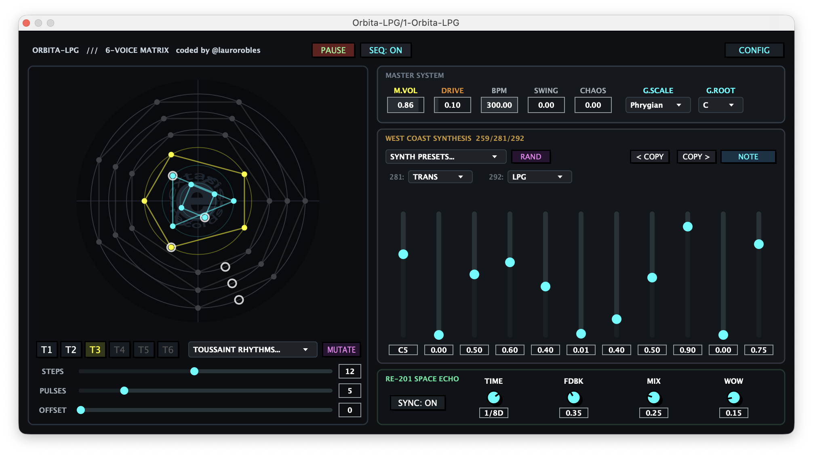

# 🪐 ORBITA-LPG

[](LICENSE)
[](https://github.com/laurorobles/Orbita-LPG)

**Orbita-LPG** is a **free and open-source** 6-voice West Coast polymetric synthesizer and generative Euclidean sequencer, licensed under the **GNU General Public License v3.0 (GPLv3)**.

Inspired by the West Coast modular design philosophy pioneered by Don Buchla (259 / 281 / 292), Orbita-LPG replaces traditional subtractive synthesis with an additive, non-linear architecture: pure oscillators sculpted through wavefolding, self-FM, pitch-drop transients, and opto-electrical Vactrol Low Pass Gates.



---

## ✨ Core Modules & Features

### ⚙️ West Coast Synthesis Engine (6 Independent Voices)
- **Morphing Oscillator (259-inspired):** Smooth continuous morph from Triangle (pure/percussive) to Square (hollow/rich).
- **1st-Order ADAA Wavefolder:** Folds the waveform via `sin(x * pi/2)` using Anti-Derivative Anti-Aliasing (ADAA) to generate rich metallic harmonics with minimal aliasing and zero latency.
- **Auto-FM Feedback:** Phase self-modulation for bells, aggressive metallic timbres, and chaotic transients.
- **Pitch-Drop Envelope:** Dedicated exponential pitch transient for analog kicks, toms, and laser zaps.
- **White Noise Strike:** Pre-LPG noise injection for snares, hats, and physical strike transients.

### 💡 Optical Vactrol Low Pass Gate (292) & Function Generator (281)
- **Buchla 281 Modes:** `TRANS` (percussive one-shot), `SUST` (gate-held sustain), and `CYCLE` (continuous self-retriggering LFO/drone loop).
- **Buchla 292 Modes:** `VCA` (clean amplifier), `LPG` (coupled optical vactrol filter + amp), and `VCF` (resonant 12 dB/oct State Variable Filter).
- **Optical Response (`RESP`):** Models CdS photo-resistor decay inertia (15 ms – 1500 ms) for authentic "Buchla Bongo" acoustic ringing.

### 🎲 Polymetric Euclidean Sequencer & Interactive Radar
- **6 Simultaneous Euclidean Rings:** Independent `Steps` (2–32), `Pulses` (0–32), `Offset` (0–31), and `Rate` (`1/4`, `1/8`, `1/16`, `1/32`).
- **Real Groove Swing & Chaos:** Sample-accurate PPQ swing engine plus Xorshift PRNG chaos modulation.
- **Live Vactrol-Glow Radar:** Click any ring directly to select a track (right-click to mute) and watch each voice's optical vactrol energy pulse in real time.
- **26 Master Genre Kits & 25 Per-Voice Synth Presets:** Instant inspiration plus XML preset Save/Load.

### 🌐 Global FX, Routing & MIDI
- **Stereo RE-201 Space Echo:** Stereo tape delay with tempo sync, quadrature LFO Wow/Flutter, warm tape feedback filtering, and smooth pitch-glide time modulation.
- **Global Scale Quantizer:** 14 musical scales + Root note, with per-track `NOTE` / `Hz` toggle.
- **Multi-Output Audio:** Stereo Master bus plus 6 individual stereo track outputs (`Track 1` – `Track 6`).
- **Generative MIDI Out & Multi-Timbral MIDI In:** Broadcasts sample-accurate MIDI notes on channels 1–6 to drive external synths/hardware, and accepts MIDI drum triggers (`Ch 1, C1–F1`) or chromatic playing (`Ch 1–6`).

---

## 🛠 Installation

**Pre-built Binaries (Free — No License Required):**
- **macOS** (10.13+, Universal Apple Silicon & Intel): VST3, AU, CLAP, Standalone.
- **Windows** (10/11 64-bit): VST3, CLAP, Standalone.
- **Linux** (Ubuntu 20.04+ 64-bit): VST3, CLAP, Standalone.

1. Download the `.zip` archive for your OS from the **[Releases](https://github.com/laurorobles/Orbita-LPG/releases)** page.
2. Unzip and run the included installer script, or copy the plugin files manually:
   - **macOS VST3:** `~/Library/Audio/Plug-Ins/VST3`
   - **macOS AU:** `~/Library/Audio/Plug-Ins/Components`
   - **Windows VST3:** `C:\Program Files\Common Files\VST3`
   - **Linux VST3:** `~/.vst3`
3. Rescan plugins in your DAW and load **Orbita-LPG**.

---

## 💻 Building from Source

Orbita-LPG uses CMake and automatically fetches JUCE 8 via `FetchContent`.

### Prerequisites
- CMake 3.15+
- C++17 compiler (Xcode / Clang on macOS, MSVC on Windows, GCC/Clang on Linux)
- On Linux: `libasound2-dev libjack-jackd2-dev libfreetype6-dev libx11-dev libxcomposite-dev libxcursor-dev libxext-dev libxinerama-dev libxrandr-dev libxrender-dev libwebkit2gtk-4.1-dev libglu1-mesa-dev`

### Build Commands
```bash
git clone https://github.com/laurorobles/Orbita-LPG.git
cd Orbita-LPG
cmake -B build -DCMAKE_BUILD_TYPE=Release
cmake --build build --config Release --parallel
```

---

## 📜 License & Contributing

Orbita-LPG is free software licensed under the **[GNU General Public License v3.0](LICENSE)**.
Contributions, bug reports, presets, and pull requests are welcome! See [CONTRIBUTING.md](CONTRIBUTING.md).

---
*Developed with ❤️ using JUCE by Lauro Robles / Extasis Records (laurorobles@gmail.com).*
